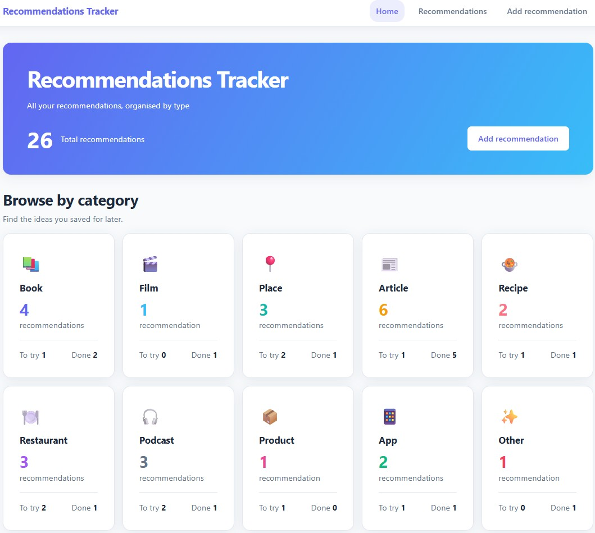
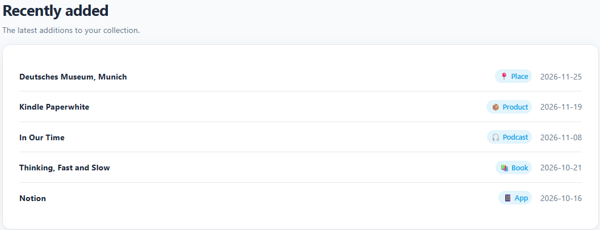
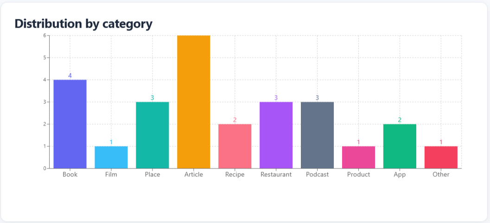
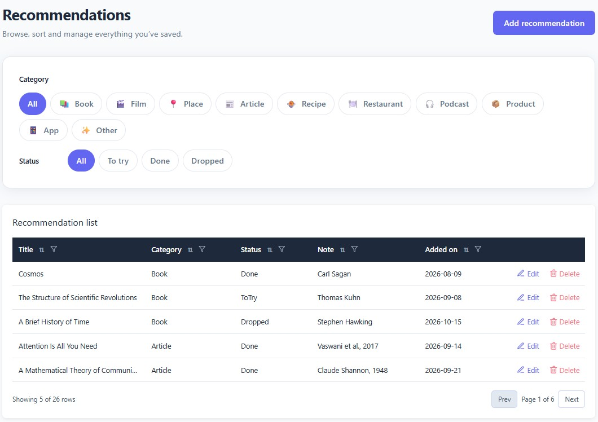
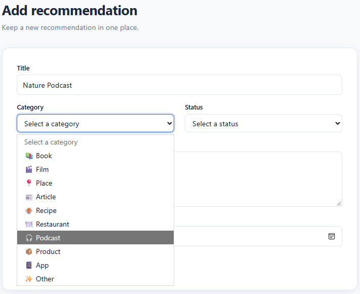

# Recommendations Tracker

A web application for keeping recommendations in one place, organised by type.

Recommendations tend to arrive in scattered ways: a book mentioned in conversation, a podcast suggested in a message, a restaurant noted in passing. Recommendations Tracker stores them in a single list, so they can be found again later and marked once they have been tried.



## Features

### Category overview

The home page shows the total number of recommendations and one card per category: book, film, place, article, recipe, restaurant, podcast, product, app and other. Each card has an icon, the number of recommendations in that category, and how many are still to try or already done.

### Recently added

A list on the home page shows the five latest additions, each with its title, category and date, so new entries are visible without opening the full list.



### Distribution chart

A bar chart shows how the recommendations are split across the ten categories, with the count above each bar.



### Recommendations list

The Recommendations page lists all entries in one table. Columns can be sorted and filtered, entries can be edited or deleted, and long lists are split into pages.

Two rows of filter buttons sit above the table:

- **Category:** shows only one type, such as articles or podcasts.
- **Status:** shows only entries that are to try, done or dropped.

Both filters can be combined, and "All" clears either one.



### Adding a recommendation

A short form creates a new entry with a title, a category, a status, an optional note (for example who made the recommendation or why it was saved) and a date.



## Run it

```bash
docker compose up --build
```

| | |
| --- | --- |
| Web app | http://localhost:3000 |
| API | http://localhost:8000 |
| API docs | http://localhost:8000/docs |

## Run it without Docker

Backend (Python 3.11 or later), on port 8000:

```bash
cd backend
pip install -r requirements.txt
python main_api.py
```

Frontend (Node.js 20 or later), on port 3000:

```bash
cd frontend
npm install
npm run dev
```

## Data

The backend stores its data in a SQLite file under `backend/data/` (the
`sqlite_data` volume with Docker Compose). Set `DATABASE_URL` to use another
database.

To fill the app with sample entries for a preview, start the backend and run:

```bash
python scripts/seed.py
```


## Pointing the frontend at another backend

The frontend reads the API address from `VITE_API_URL` and falls back to
`http://localhost:8000`:

```bash
cd frontend
VITE_API_URL=http://localhost:8080 npm run dev
```

Vite reads `VITE_*` variables at build time, so a production image takes the
address as a build argument: `docker-compose.yml` passes it that way.


---

[](https://github.com/BESSER-PEARL/BESSER)

Generated by [BESSER](https://github.com/BESSER-PEARL/BESSER), the open-source low-code, model-driven platform, from the B-UML model in [`buml/`](buml/).

[Open the model in the BESSER editor](https://editor.besser-pearl.org/?buml=https://github.com/DaoudiNadia/recommendationstracker/blob/main/buml/domain_model.py) · [More apps built with BESSER](https://github.com/BESSER-PEARL/Built-with-BESSER) · [Generation details](BESSER_GENERATION.md)
<!-- besser:end -->
